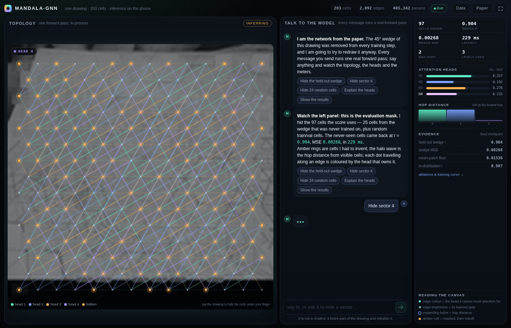

# mandala-gnn

**Project page:** https://boogercheeseonrye.github.io/mandala-gnn/  
**Paper:** https://boogercheeseonrye.github.io/mandala-gnn/paper.html  
**Weights:** https://huggingface.co/BoogerCheeseOnRye/mandala-gnn  
**Ablation sweep:** https://huggingface.co/datasets/BoogerCheeseOnRye/mandala-gnn-ablations



A small research prototype built from three hand drawings: a geometric GNN
whose *topology is read off the sketches*, a residual multi-scale pyramid on
top of it, and a real training/eval loop with ablations.

The prompt that started it asked for a hybrid geometric GNN over a hexagonal
sketch, radial edges for sparse message passing, symmetry-aware attention, and
a pyramid of residual blocks with learnable radial biases. That is what the
code does -- with the drawings as data rather than decoration.

## The idea in one picture

```
 drawing  ---------------->  mesh (nodes + radial/ring/spoke edges)
   |                              |
   |  local patch per node        v
   +------------------->  RadialAttention  (content + geometry bias + symmetry
   |                        |              harmonics + learned edge gate)
   |                        v
   |                   ChaosPyramid  (cell-pool down x3, gated residual up,
   |                        |         learnable per-level read-out weights)
   |                        v
   +------------------->  patch prediction  ->  redrawn image
```

* `mandalanet/lattices.py` -- the three sketches as graphs: honeycomb with
  6-fold radial edges, concentric spoke mandala, hub-and-spoke chart, plus
  jittered/random/grid controls and an edgeless variant.
* `mandalanet/layers.py` -- `RadialAttention`: attention logits get a learnable
  bias from an RBF over edge length, cos/sin harmonics of the edge angle (the
  n-fold symmetry), both endpoint radii and the edge type. Messages are scaled
  by a learned edge gate, so the model can close edges the drawing does not
  support. `RadialBlock` wraps it pre-norm with an MLP.
* `mandalanet/pyramid.py` -- spatial cell pooling down, gated residual skips
  back up, softmax mixture of per-level mean+max read-outs.
* `mandalanet/model.py` -- `MandalaNet` (shared trunk, patch head, class head).
* `mandalanet/data.py` -- the sketches as data: patch sampling (square or
  disc), masks, the held-out wedge, rotation augmentation.
* `mandalanet/train.py`, `mandalanet/ablate.py` -- training and the sweeps.
* `mandalanet/pyg_adapter.py` -- optional: the same layer as a
  `torch_geometric.nn.MessagePassing` module, exact parity with the pure-torch
  path (tested in `tests/smoke.py` when PyG is installed).
* `docs/design-notes.md` -- prompt-to-code map and the decisions behind it.
* `docs/results.md` -- full tables, including the controls and the failures.

## Task

Masked patch reconstruction on the drawing itself. Each mesh node owns an 8x8
px patch of the sketch (pooled to 4x4 values), so "reconstruct" means "redraw
the pencil". Node features are those patches plus a visibility flag; the model
predicts the patch of every hidden node.

Three disjoint hidden sets, so the numbers mean something:

| set | what it is | what it tests |
|---|---|---|
| `train_mask` | 20% of cells outside one sector | fitting |
| `val_mask` | a different 20% outside that sector | generalisation |
| `wedge_mask` | one 45 deg sector, never trained on | symmetry inpainting |

A position-memorising model cannot fill in the wedge: those positions are never
seen. A model that carries the sketch's angular structure across the graph can.

## Run it

```bash
python -m venv .venv && .venv/bin/pip install torch numpy pillow   # see requirements.txt
.venv/bin/python tests/smoke.py
.venv/bin/python -m mandalanet.train --drawing drawings/hex-tessellation.jpg \
    --mesh hex --steps 400 --out runs/main-hex
.venv/bin/python -m mandalanet.train --task classify --steps 150 --out runs/classify
.venv/bin/python -m mandalanet.ablate --axis mesh --seeds 2 --workers 3 --out runs/abl-hex
./tools/experiments.sh        # everything, ~45 min on this phone
```

`runs/<name>/recon.png` is `drawing | what the model sees | prediction |
composite` (3x). Docs: `docs/design-notes.md`, `docs/results.md`.

## Live demo

```bash
./run.sh            # start the server if needed, then open localhost:8000
./run.sh status
./run.sh stop
```

The static project page in `docs/` (GitHub Pages) is generated with
`tools/build_pages.sh`; it embeds the paper, the results and a recorded clip,
because Pages cannot run the Python server.

`run.sh` is also on PATH as `mandala-gnn` and installed as a Linux app
(`~/.local/share/applications/mandala-gnn.desktop`), so it can be opened from
the app drawer without a terminal.

The page comes up in about a second, before torch or the checkpoint is in
memory: the drawing, mesh and metrics are served from `demo.json` next to the
weights. Its **launch the model** button imports torch, builds the network and
loads `model.pt` (about 4.5 s cold on this phone, 0.3 s of it the weights), then
runs the held-out-wedge demo. `tools/dump_demo_state.py` regenerates the cache
after retraining.

The page is one fixed, no-scroll cockpit in landscape (topology | chat | live
rail); portrait phones get a stacked, scrollable fallback and a fullscreen
button tries to lock orientation there. The **Paper** and **Data** buttons open
full-screen sheets instead of stretching the live view.

Chat is the only control surface: say anything and it runs one real forward
pass. `hide sector 4`, `held-out wedge`, `hide 24 random cells`, `clear`,
`results` and `heads` are understood; any other sentence is deterministically
mapped to a sector, masked and reconstructed, and the reply reports what it
masked and the measured r / MSE / latency. A tap on the drawing masks the cells
under the finger. Every gate, hop count, latency and predicted patch on the
canvas comes from that pass, not a recording.

The right rail shows the four attention heads: each meter is that head's share
of the attention routed in the pass just run (the edge gate itself is a function
of edge geometry, so it does not change between passes — the attention does),
the canvas colours each edge by the head carrying the most attention over it,
a halo wave follows the BFS hop distance from visible cells, and head-coloured
pulses travel along the strongest edges.

Endpoints: `GET /api/state`, `POST /api/load`, `POST /api/redraw` (returns
`gates`, `headEdge`, `heads`, `hop`, `top`, `nodeErr`, composite/prediction
PNGs), `GET /recon.png` — the page is plain HTML/CSS/JS with no build step.

## Results

Held-out 45 degree sector of the hex-tessellation drawing, never trained on:

| | wedge r | wedge MSE |
|---|---|---|
| mean-patch floor | - | 0.0154 |
| plain MLP (no edges, no pyramid) | 0.00 | 0.0286 |
| pyramid pooling, **no edges** | 0.73 | 0.0177 |
| **honeycomb mesh, full model** | **0.90** | **0.0030** |
| same nodes, random edges (`rewired`) | 0.88 | 0.0033 |
| square grid, disc patches | 0.99 | 0.0019 |

What survives scrutiny:

* Edges are worth 6x on the missing wedge; the pyramid is worth another 4-5
  points of correlation over a flat stack; removing the angular symmetry bias
  collapses the run (0.24 r); removing the edge gate collapses it too (0.08 r).
* The *specific* lattice is not measurably doing the work: random edges on the
  same 203 node positions score within 2 points of the honeycomb. The grid's
  6-point win with square patches disappears with disc patches - it was patch
  tiling, not topology.

Beyond reconstruction, three transfer experiments test the lattice directly,
and all three come out negative: the drawing is not a positional prior for a
language model (R0 — 4.661 bits/code against 4.534 for plain order, and within
0.03 of a shuffled control), the pair-bias mechanism is 3% behind RoPE on
byte-level code (R1), and the drawing is not a better computation graph than a
random one with the same nodes and edges (R2 — 0.996/0.982 against 1.000 on the
203-node layout, with a degree-matched rewired control at 1.000). Designs,
costs and kill criteria: **[ROADMAP.md](ROADMAP.md)**.

Full tables, both patch shapes, all seeds: **[docs/results.md](docs/results.md)**,
and as raw files on Hugging Face:
[huggingface.co/datasets/BoogerCheeseOnRye/mandala-gnn-ablations](https://huggingface.co/datasets/BoogerCheeseOnRye/mandala-gnn-ablations).

## Publishing to Hugging Face

The checkpoint and the sweeps are mirrored there, generated from this repo so
nothing is hand-maintained on the Hub:

```bash
hf auth login          # once
./tools/push_hf.sh     # model + dataset (+ Space, if the account can host one)
./tools/push_hf.sh --stage   # assemble the folders, upload nothing
```

`tools/push_hf.sh model` and `... dataset` are the two repos that exist:
`BoogerCheeseOnRye/mandala-gnn` (weights, metrics, `demo.json`) and
`.../mandala-gnn-ablations` (every sweep, plus a flattened `summary.csv`).
The third target is a Docker Space that serves this exact cockpit on port 7860;
its files are in `tools/hf/` and are staged the same way, but Hugging Face now
requires a PRO subscription to host Docker Spaces, so it is not published.

## Energy head: one search loop, measured and closed

The obvious follow-up is to search instead of predicting once: freeze the
backbone, learn a scalar `E(h) = Σφ(h_i) + Σψ(h_i, h_j, e_ij)` over its node
states, and descend it on the hidden cells. It is implemented in
`mandalanet/energy.py` (6,946 parameters) and tested end to end by
`tools/energy_experiment.py` on all three drawings, merged by
`tools/energy_compare.py`.

| test | hex (203 nodes) | mandala (61) | chart (25) |
|---|---|---|---|
| baseline wedge r | 0.9057 | 0.7663 | 0.9357 |
| E(true) − E(model's guess) | +0.08% | +0.36% | −0.03% |
| descend h, 25 steps | 0.9049 | 0.7622 | 0.9354 |
| best of 8 sampled states, Δr | −0.0007 ± 0.0009 | −0.0003 ± 0.0036 | +0.0002 ± 0.0005 |
| descend the completion, 10 steps | 0.832 → 0.156 | 0.697 → 0.015 | 0.789 → 0.132 |
| visibility ranking, 24 pairs | 24/24 | 19/24 | 14/24 |
| per-node E vs per-node error | −0.52 | −0.66 | +0.75 |

Two things hold on all three drawings: the energy is flat along the quality
axis (within 0.4% from the guess to the true patches, sign inconsistent), and
descending it never improves the redraw -- while letting the patches themselves
move destroys the drawing as the score improves. The visibility ranking does
*not* replicate (24/24, 19/24, 14/24 against 12/24 for chance), so "visibility
scorer" is a fact about the 203-node graph, not about the method.

The last open question was reranking: given eight completions, pick the one
closest to the truth. Four candidate regimes, 60 training and 40 held-out
masks (plus the wedge) per drawing, labels from the decoded patches so they
never enter the head's input (`tools/energy_selector.py`,
`runs/energy-selector/results.json`). Held-out pairwise accuracy, chance 0.5:

| candidates | hex | mandala | chart |
|---|---|---|---|
| 8 dropout samples of the same input | **0.500** | **0.505** | **0.507** |
| same mask, different amounts visible | 0.807 | 0.649 | 0.562 |
| same mask, same count, different subsets | 0.671 | 0.506 | 0.681 |
| fixed temperature, σ 1.0 / 2.0 | 0.463 / 0.475 | 0.447 / 0.553 | 0.514 / 0.539 |
| *neighbour smoothness*, sampler (no learning) | 0.598 | 0.451 | 0.590 |
| *count of visible cells* (no learning) | 0.794 | 0.642 | 0.525 |

On the regime a reranker meets it is at chance on all three (pooled 0.504 ±
0.014) while fitting its training masks at 0.598-0.613, and a one-line
smoothness prior beats it on two drawings. Where it does order above chance it
is either reproducing a count (0.807 against 0.794) or ranking which
fixed-size subset was seen (0.671 / 0.681) -- neither is a question a search
loop asks. The inverted-label head falls to 0.345 on the subset pairs where the
signal is real and sits at chance on sampler pairs where there is none, so the
loop can learn labels; there are just no useful ones at a fixed input.

What that closes is test-time search *and* reranking on a frozen backbone's
states -- not the direction this repo is on. Topology is untouched by the
result. Write-up and figures:
**[docs/energy.html](https://boogercheeseonrye.github.io/mandala-gnn/energy.html)**.

The next branch is images *and* code in one small model, and its ten-step plan
(with kill criteria) is in [ROADMAP.md](ROADMAP.md#images-and-code-generation-ten-steps-small-and-fast).
Step 1 is measured: the 385 k byte model reproduces R1 at 2.478 bits/byte and
generates at 65-83 B/s single-thread (1 of 16 continuations compiles), while
the 405 k GNN completes a held-out wedge at r 0.906 but only reaches r 0.360
when asked to draw from an empty canvas, against 0.287 for a constant image.
Step 2 froze the scoreboard: 40 hand-written docstring tasks with unit tests and
36 held-out drawings, under one SHA. On those tasks the same model compiles a
real function body on 0 of 40 (a naive `compile()` says 40 of 40, because
whitespace is valid Python) and passes 0 of 40. Those are the numbers later
steps have to beat.

## What this is not

No claim of a new architecture. The pieces -- message passing, RBF edge
features, angular harmonics, U-Net-style pooling -- are standard; the point is
that they were chosen from the drawings, and the sweep then checks whether the
sketch topology earns its keep. Half of it does: symmetry-aware attention and
the pyramid clearly pay. The hand-drawn *lattice* does not, at this task scale,
which is a more useful thing to know than a demo that only shows the good run.
