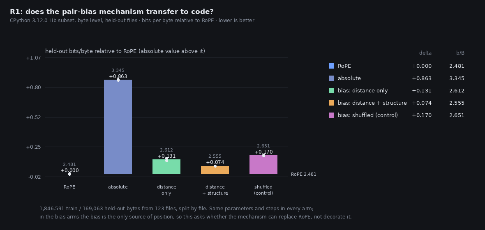
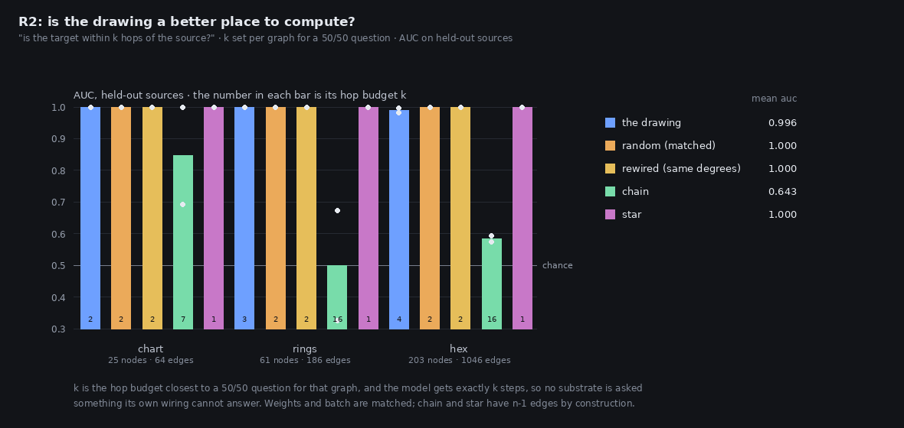
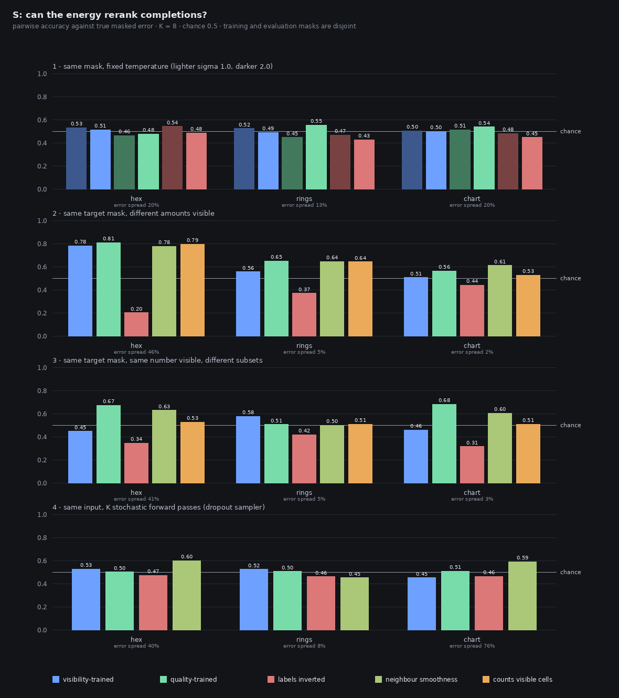
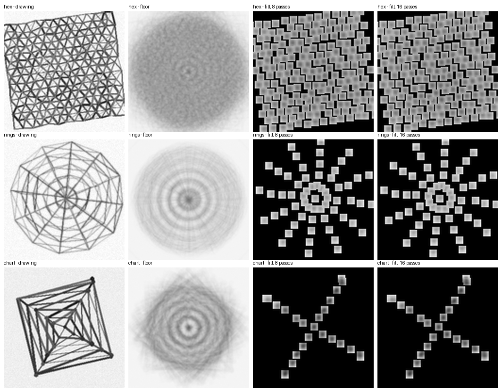
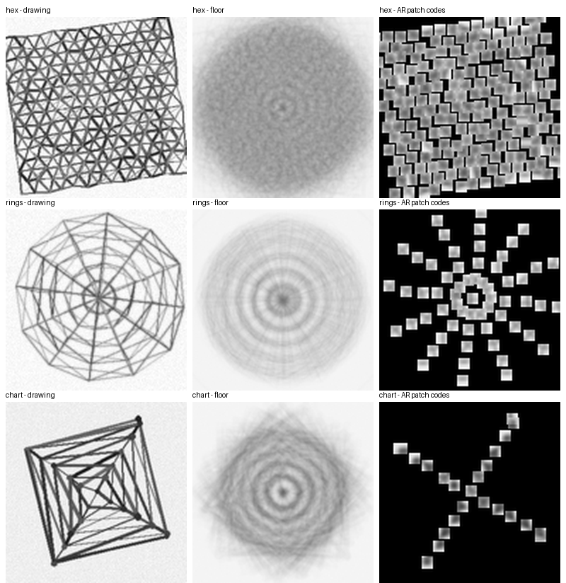

# Results

All numbers from this machine (ARM phone, 1 CPU thread per run, ~2 min per
400-step run). `wedge_corr` is the Pearson r between predicted and true patch
values on the held-out 45 degree sector that is never optimised;
`wedge_mse` is the same in squared error. Lower MSE / higher r is better.

The do-nothing predictor (predict the mean visible patch at every hidden cell)
scores **wedge MSE 0.0154** on the hex-tessellation drawing and **0.0208** on the
star mandala.

## Main runs

| drawing | mesh | nodes / edges | wedge r | wedge MSE | mean-patch MSE |
|---|---|---|---|---|---|
| hex tessellation | honeycomb | 203 / 2092 | **0.904** | **0.00268** | 0.0154 |
| star mandala | 12 spokes x 5 rings | 61 / 192 | **0.742** | **0.00553** | 0.0208 |

400 steps, 405k parameters. On the hex drawing the held-out sector is
reconstructed at 5.7x lower error than the mean-patch floor, i.e. the model is
drawing the missing wedge, not smearing grey into it. `runs/main-hex/recon.png`
shows `drawing | what the model sees | prediction | composite`.

## Graph classification

Three sketches, four training rotations each, evaluated on four *unseen*
rotations (45/135/225/315): train 1.00, test 1.00, 12 test graphs.
That is a sanity check of the invariant geometry features, not a result: with
three classes and twelve graphs a coin flip would occasionally look fine.

## Ablation 1 - topology (hex drawing, square patches, 400 steps, 2 seeds)

| mesh | nodes | wedge r | wedge MSE | val MSE | gate mean |
|---|---|---|---|---|---|
| hex (honeycomb + star edges) | 203 | 0.896 +- 0.010 | 0.00280 | 0.00184 | 0.285 |
| hex_near (6 neighbours only) | 203 | 0.893 +- 0.005 | 0.00305 | 0.00375 | 0.270 |
| rewired (*same positions*, random edges) | 203 | 0.878 +- 0.001 | 0.00325 | 0.00223 | 0.259 |
| jitter (freehand positions, kNN) | 203 | 0.871 +- 0.020 | 0.00323 | 0.00422 | 0.291 |
| random (uniform positions, kNN) | 203 | 0.882 +- 0.038 | 0.00359 | 0.00362 | 0.273 |
| grid (square lattice) | 196 | **0.960** +- 0.002 | **0.00235** | 0.00522 | 0.321 |
| rings (spoke lattice) | 61 | 0.308 +- 0.080 | 0.00089 | 0.00285 | 0.242 |
| chart (hub and spoke) | 25 | 0.520 +- 0.138 | 0.00065 | 0.00130 | 0.248 |
| none (no edges) | 196 | 0.730 +- 0.002 | 0.01770 | 0.01745 | 0.000 |

Plus the strict control: **no edges and no pyramid** (`depth=1`, a plain MLP)
scores r **0.00**, wedge MSE **0.0286** - it can only emit one constant patch,
because with no edges and no pooling every hidden cell has identical input.

### What this says

* **Message passing is doing real work.** Edges + pyramid: 0.0030 MSE. Pyramid
  pooling without edges: 0.0177. Plain MLP: 0.0286. Each step is a 3-6x
  improvement, and the gate closes to a mean of ~0.28, i.e. the model keeps
  about a quarter of the attention mass it started with.
* **The specific lattice is not.** `rewired` uses the *same 203 node positions*
  as `hex` with random edges and lands within 2 correlation points (0.878 vs
  0.896). The honeycomb's 6-fold wiring buys ~1 point over a random graph at the
  same points. The `rings`/`chart` rows are not a topology statement: they have
  61 and 25 nodes, so they simply represent the drawing with far fewer patches.
* **The grid's win is a tiling artefact.** Square patches tile a square grid
  exactly, which is free information. With disc patches (`--round-patches`,
  same runs) that advantage disappears:

| mesh (disc patches) | wedge r | wedge MSE |
|---|---|---|
| hex | 0.989 +- 0.005 | 0.00198 |
| rewired | 0.987 +- 0.004 | 0.00246 |
| grid | 0.990 +- 0.000 | 0.00193 |
| none | 0.882 +- 0.001 | 0.02165 |

  Both patch shapes are now near the ceiling, so this comparison is blunt, but
  the 6-point grid gap from the square-patch table is gone. Conclusion: the
  ranking there was about how patches cover pixels, not about graph topology.

## Ablation 2 - model knobs (hex drawing, 300 steps, 2 seeds)

| harmonics | wedge r | wedge MSE |
|---|---|---|
| 0 (no angular symmetry bias) | 0.238 +- 0.319 | 0.01283 |
| 2 | 0.870 +- 0.001 | 0.00340 |
| 4 (default) | 0.888 +- 0.014 | 0.00324 |
| 8 | **0.901** +- 0.001 | 0.00265 |

| depth | wedge r | wedge MSE | params |
|---|---|---|---|
| 1 (no pyramid) | 0.844 +- 0.014 | 0.00408 | 148k |
| 2 | 0.877 +- 0.019 | 0.00334 | 277k |
| 3 (default) | 0.888 +- 0.014 | 0.00324 | 405k |
| 4 | 0.881 +- 0.031 | 0.00320 | 534k |

| edge gate | wedge r | wedge MSE |
|---|---|---|
| on | 0.888 +- 0.014 | 0.00324 |
| off | 0.078 +- 0.130 | 0.01398 |

* The symmetry harmonics are the single biggest knob: removing them collapses
  the run (one seed even fails to train), and adding more helps up to 8.
* The pyramid is worth ~4-5 correlation points over a flat stack, with
  diminishing returns after depth 2-3.
* Removing the edge gate destabilises training completely. That is a
  confounded result - the gate also damps attention by ~0.3x, so the collapse
  is "no damping + no adaptivity", not proof that adaptivity alone is
  essential. It is worth re-running with a fixed attention temperature to
  separate the two.

## Do the drawings carry beyond reconstruction?

Three follow-up experiments, all negative. Designs, costs and kill criteria are
in `ROADMAP.md`; the raw numbers are in the JSON next to each run.

**R0 — geometry as a sequence prior** (`runs/seq/results.json`). Six matched
causal transformers over scanline-ordered patch codes of synthetic renders of
all three layouts (600 train / 75 held-out per layout). Order wins: raster
index **4.534** bits/code, absolute (x,y) 4.558, distance+angle 4.661, distance
only 4.669, shuffled-coordinate control 4.681, no position 4.700; seed spread
≤0.011. The true geometry is within 0.03 bits of its shuffled control, so the
bias is inert. The reason is structural: an AR model is asked for token t+1,
whose position is already fixed by the order, so there is no query position for
the geometry to route to. Geometry is a query-time prior — which is why it helps
masked reconstruction and not next-token prediction.

**R1 — the pair-bias mechanism on code** (`runs/code/results.json`). R0 killed
the drawing as a positional code, so R1 tests what survived: the mechanism — a
learned pair bias over relative position, plus structure the corpus actually has
(indentation, bracket depth, line distance). Corpus is a pinned CPython 3.12.0
`Lib/` subset, byte level, split by file: 1.85 MB train / 169 KB held out.
Five arms, dim 96, 3 layers, context 256, 1,200 steps, two seeds. In the three
bias arms the bias is the **only** source of position, so the question is
whether it can replace RoPE, not decorate it.

| arm | bits/byte | vs RoPE |
|---|---|---|
| RoPE | **2.481** | — |
| bias: distance + structure | 2.555 | +3.0% |
| bias: distance only | 2.612 | +5.3% |
| bias: shuffled (control) | 2.651 | +6.8% |
| absolute position | 3.345 | +34.8% |

Seed spread ≤0.010, so every gap is 7–20× noise, and the ordering is identical
at 300 steps (RoPE 3.229, structure 3.370, distance 3.423, shuffled 3.441,
absolute 3.613). RoPE wins; the rung is killed at its 2% threshold.

The useful detail is *inside* the bias family: `distance + structure` beats
`distance only` by 2.2% and the shuffled control by 3.6%. The shuffled control
has the same capacity and the same feature distribution, so that gap is the
information rather than the machinery — indentation, bracket depth and line
distance are real, learnable relations. They are just not worth 3% of
bits/byte. Absolute positions collapse (+34.8%), which is the expected failure
for learned offsets on random windows.

**R2 — the drawing as a computation graph** (`runs/topology/reach.json`). A
recurrent graph net with weights shared across steps, state on the nodes, and
messages along a fixed edge set, asked "is the target within k hops of the
source?". k is chosen per graph for a 50/50 question and the model gets exactly
k steps, so no graph is asked something its wiring cannot answer; pairs are
sampled half positive; 20% of source nodes are held out. AUC, two seeds:

| layout | drawing | random (same nodes/edges) | rewired (same degrees) | chain | star |
|---|---|---|---|---|---|
| chart (25 nodes, 64 edges) | 1.000 / 1.000 | 1.000 / 1.000 | 1.000 | 1.000 / 0.693 | 1.000 |
| rings (61, 186) | 1.000 / 1.000 | 1.000 / 1.000 | 1.000 | 0.325 / 0.673 | 1.000 |
| hex (203, 1046) | 0.996 / 0.982 | 1.000 / 1.000 | 1.000 | 0.573 / 0.593 | 1.000 |

The drawing ties a connected random graph at identical node and edge counts on
chart and rings, and trails it on hex. The rewired control — the drawing's exact
degree sequence, random wiring — is indistinguishable from the random graph, so
the deficit is the drawing's specific edges: at fixed edges a mesh has diameter
12 where random has 4, and needs more hops (k=4 vs k=2) for the same question.
Random wiring at fixed degree is an expander; a lattice is not. Chains fail
outright, with the training loss pinned at ln 2 = 0.6931 at one or more
checkpoints: a 16-hop signal under mean aggregation on a degree-2 path is
attenuated by about 2^-16, so there is no gradient to learn from.

**S — the energy head as a reranker** (`runs/energy-selector/results.json`).
The energy head's last surviving job was selection: given K completions, pick
the one closest to the truth. It was trained for a different question — tell a
state that saw most of the drawing from one that saw little — and does that
perfectly. S asks the selection question in four candidate regimes, on all
three drawings, with 60 training and 40 held-out masks per drawing (41 scored, including
the wedge), K = 8, and 0.15–0.35 of the cells visible. Labels are the masked MSE
of the decoded patches, so they never touch the head's input. Three heads are
scored on identical candidates: the published visibility head, a head trained
with a pairwise hinge on the true ordering, and the same head trained on the
*opposite* ordering (a learnability control — it must land below chance
wherever a signal exists). Two non-learned controls are scored alongside: pick
the candidate that saw the most cells, and a one-line neighbour-smoothness
prior.

Held-out pairwise accuracy over 41 masks x 28 pairs, chance 0.5, `quality` head
unless marked:

| candidates | what differs between them | hex | mandala | chart | error spread |
|---|---|---|---|---|---|
| same mask, fixed temperature (σ 1.0 / 2.0) | noise realisation only | 0.463 / 0.475 | 0.447 / 0.553 | 0.514 / 0.539 | 20–37 / 13–28 / 20–48% |
| **same input, K dropout samples** | the model's own noise | **0.500** | **0.505** | **0.507** | 40 / 8 / 76% |
| same target mask, same number visible | which cells were seen | 0.671 | 0.506 | 0.681 | 41 / 5 / 3% |
| same target mask, different amounts visible | how many cells were seen | 0.807 | 0.649 | 0.562 | 46 / 5 / 2% |
| *neighbour smoothness*, swap family (no learning) | — | 0.628 | 0.499 | 0.603 | — |
| *count of visible cells* (no learning) | — | 0.794 | 0.642 | 0.525 | — |
| *inverted labels*, sampler family | — | 0.473 | 0.461 | 0.462 | — |

* **On the regime a reranker actually faces — K samples of the same input — the
  head is at chance on all three drawings**: 0.500, 0.505, 0.507, while fitting
  its training masks at 0.598–0.613. Pooled: 0.504 ± 0.014 over 123 mask-cells
  for the sampler, 0.498 ± 0.009 over 246 for the fixed-temperature family.
  At every temperature, on every drawing, it learns something that does not
  transfer.
* **A parameter-free smoothness prior beats it where there is spread.** On the
  hex drawing the head captures none of the available gain while the
  neighbour-smoothness statistic reaches 0.598 pairwise and 27% of the gain,
  ahead of the head by 0.097 (paired t = 2.7); on the chart it is 0.590, ahead
  by 0.083 (t = 2.2). It loses on the mandala (0.451), whose sampler candidates
  differ by only 8% in error.
* **Where it does order above chance, it is a setting a reranker never has.**
  With candidates that each hid a different random subset of the *same number*
  of cells, it reaches 0.671 on hex and 0.681 on the chart; on hex its pick is
  5.6% better than an average candidate, 37% of the available gain. That is
  "which observation was better", not "which sample is better".
* **Where candidates differ in how much they saw, it reproduces a count.**
  0.807 against the count's 0.794 on hex (+0.014 ± 0.005, t = 2.9), 0.649/0.642
  on the mandala, 0.562/0.525 on the chart. Nothing a head gives you that
  counting visible cells does not.
* **The controls say the loop can learn labels at all.** With the true ordering
  the head reaches 0.671 on hex swap; with the ordering flipped it falls to
  0.345 (2 of 41 masks above chance) and to 0.201 on the context family. On the
  sampler family the inverted head sits at chance too (0.473/0.461/0.462), which
  is the same statement: there is nothing there to invert.
* **The mandala is uninformative in two of four families** — 5–8% candidate
  spread, so almost nothing to rank. That is the drawing, not the head, and it
  is why every claim above is per drawing.

So the search loop stays closed, for a precise reason: the head's signal is
about *how much was seen*, which the caller already knows, and when it is made
to rank quality at fixed input it memorises masks instead. The one thing it can
do that a count cannot — rank which fixed-size subset of an observation was
more informative — is not the problem a search loop has.

## Images and code generation: the ten-step branch

The branch's target is one small model that both draws and writes code, inside a
stated envelope: **≤ 5 M parameters, ≤ 25 MB int8, ≥ 1 kB/s on this phone, ≤ 2 s
to finish a drawing**. Each step below was pre-registered with a gate and a kill
in [ROADMAP.md](https://github.com/BoogerCheeseOnRye/mandala-gnn/blob/main/ROADMAP.md#images-and-code-generation-ten-steps-small-and-fast);
a missed gate fires its kill instead of a retry at a slightly better setting.

| step | what was measured | gate | outcome |
|---|---|---|---|
| 1 | meter: 385 k byte model at 2.4777 bits/byte, 79 B/s; 405 k GNN at wedge r 0.906, fill-from-empty r 0.360 vs 0.287 floor | table exists | met |
| 2 | 40 docstring tasks with unit tests + 36 held-out drawings, one SHA | sha verifies, all references pass | met |
| 3 | capacity 1.26 M → 2.296 bits/byte; 3x tokens → 2.156 bits/byte | body compiles, test passes | **missed: 0 of 40 both arms** |
| 4 | numpy int8 decode of the same weights | ≥ 1 kB/s | met: 1,075 B/s |
| 5 | conditional code | — | **cut** by step 3's kill |
| 6 | GNN fill loop vs AR patch decoder on 36 drawings | 2x the floor, <= 2 s | **missed: 0.55x and 0.81x** (both <= 1 s) |

Two things about the code side are worth stating plainly. First, held-out
bits/byte falls monotonically with parameters and tokens (2.478 → 2.296 →
2.156) while the task metric stays at zero: at this budget the model is a
completion model, and a completion model is not a function body. Second, the
naive `compile()` check says 40 of 40 tasks "compile", because a body of spaces
is valid Python; the metric used here is "a statement that is not a string
literal", which is 0 of 40. That tightening is why step 3 is closed rather than
ambiguous.

Step 4's speed came from moving the sampler out of torch:

| runtime (1 thread, 96 bytes) | 1 stream | 4 streams |
|---|---|---|
| torch, full window per byte | 87 B/s | — |
| torch, KV cache, oneDNN on | — | 445 B/s |
| torch, KV cache | — | 737 B/s |
| numpy, int8 weights | **1,075 B/s** | **2,032 B/s** (1,464 sampled) |

A (1, 96) x (96, 288) matmul costs 400–1,400 µs through oneDNN on this device and
~24 µs with oneDNN disabled; one cached torch step makes ~230 aten calls, so the
floor is dispatch, not arithmetic. The numpy sampler makes ~230 numpy calls at
~2.8 µs each. Folding each layer norm's affine into the matmul that follows it
and rope into a single 24x24 matmul took the same weights from 433 to 1,075 B/s.
The OpenMP thread count is not a detail: at the default eight threads every tiny
matmul pays a pool wake-up and the loop runs at 754 B/s.

Equivalence was checked, because a fast sampler that generates different bytes
is worthless: fp32 logits match torch to 5.7e-6, int8 logits differ by up to
0.08 but give byte-identical greedy output on the four meter prompts and all 40
frozen tasks, and held-out bits/byte moves 2.4777 → 2.4782.

### Step 6, the drawing generator

Same 36 frozen drawings, same renderer, same scoring for both candidates. Two
controls make the numbers readable: the **floor** is the mean of 64 *training*
drawings, and the **ceiling** is the drawing's own patches pushed through the
same renderer — a model that emits one 4x4 patch per node cannot paint the ink
between nodes, so that is the best it can do. The informative number is the
share of that gap a candidate closes.

| layout | floor | ceiling | GNN fill, 8 passes | gain | AR patch codes | gain |
|---|---|---|---|---|---|---|
| hex | 0.0467 | 0.0181 | **0.0350** (r 0.493) | 41% | 0.0444 (r 0.327) | 8% |
| rings | 0.0302 | 0.0107 | **0.0241** (r 0.476) | 32% | 0.0465 (r 0.306) | -83% |
| chart | 0.1119 | 0.0189 | **0.0457** (r 0.681) | 71% | 0.0622 (r 0.538) | 53% |
| all | 0.0629 | 0.0159 | **0.0349** | 60% | 0.0510 | 25% |

Seconds per drawing on one thread: 0.48 s for the fill loop, 0.36 s for the
decoder. Both pass the 2 s bar; neither reaches 0.50x the floor, so the gate is
missed by both and the page claims no drawing generator.

Three candidate explanations for the fill loop's miss, each tested:

* **Transfer, not ability.** The photo-trained checkpoints score 0.0885 (1.41x
  the floor, r -0.047) on the same drawings. Training on synthetic drawings is
  what moves that to 0.55x; it is necessary and not sufficient.
* **An out-of-distribution first pass.** Training sampled masks up to 0.9, but a
  fill from empty starts at 1.0. Retrained to include the empty canvas: 0.0350,
  inside noise. Real mismatch, no effect.
* **Error compounding.** The loop conditions on its own output and was never
  trained to. Revealing the true patch after every pass changes the score by
  nothing (0.0349 either way; the model's own output moves by 0.009 on a 0-1
  range). It is a low-pass filter, so drift is not the limiter — per-cell
  accuracy is.

The decoder loses on quality and wins on speed: 4.891 bits/patch-code at 15.4%
accuracy (R0's raster-index arm reached 4.534 on fewer steps), 0.81x the floor
sampled and 0.83x greedy, and worse than the floor on rings, where 61 tokens
leave a causal model almost no context.

## Caveats

* One drawing, two seeds, 300-400 steps. Differences under ~0.02 r are noise;
  only the big gaps (edges vs none, harmonics 0 vs 8, gate on/off) should be
  trusted.
* The task is low-frequency: each node predicts a 4x4 average of an 8x8 patch,
  so most of the signal is "how much ink is around here". A topology that
  matches the drawing's line structure has little extra to offer. A harder
  task - predicting the line pattern itself, or classifying tessellation
  families - is where the lattice hypothesis should be tested next.
* `wedge_corr` is computed over raw patch values, so reproducing the overall
  ink level contributes. Read it next to `wedge_mse` and the mean-patch floor.
* The classification number is a smoke test (3 classes, 12 test graphs).
